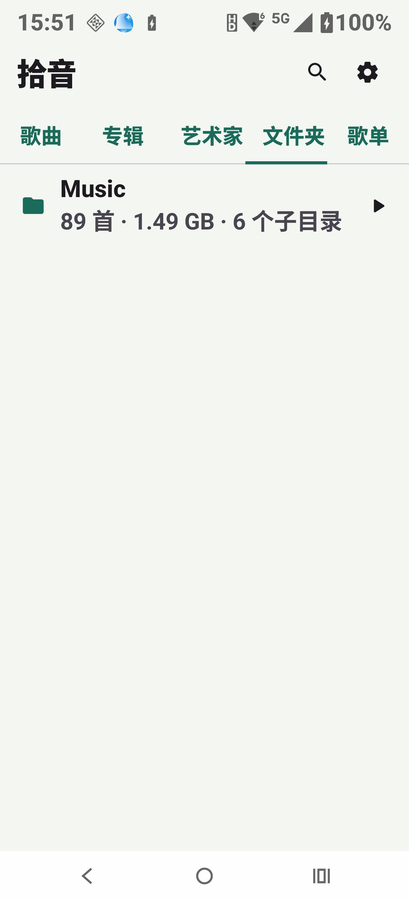
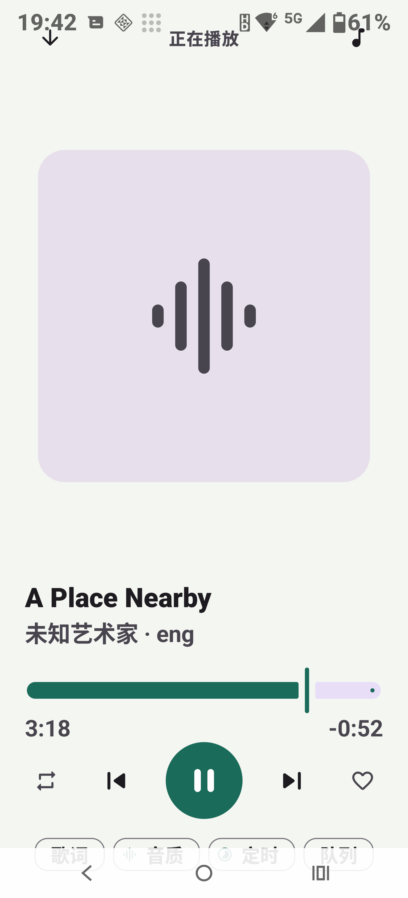

<p align="center">
  
</p>

<h1 align="center">拾音</h1>

<p align="center">纯本地安卓音乐播放器 · <b>不联网</b></p>

<p align="center">
  
  
</p>

APK 未声明 `INTERNET` 权限，系统在层面禁止任何网络连接。

## 下载

APK 在 [Releases](../../releases) 里（debug 签名，可直接安装自用）。

> ⚠️ debug 签名适合自用，**不适合上架或长期分发**。需要正式签名版请自行生成 release keystore。

## 构建

```powershell
$env:JAVA_HOME='E:\Android\jdk17'
$env:ANDROID_HOME='E:\Android\Sdk'
E:\Android\gradle-8.11.1\bin\gradle.bat assembleDebug
# 产物：app/build/outputs/apk/debug/app-debug.apk
```

工具链：AGP 8.10.1 / Gradle 8.11.1 / Kotlin 2.2.10 / KSP 2.2.10-2.0.2 / compileSdk 36 / minSdk 26。

## 离线保证怎么落实

`AndroidManifest.xml` 里对 `INTERNET`、`ACCESS_NETWORK_STATE`、`ACCESS_WIFI_STATE`、定位权限都写了
`tools:node="remove"`，即使某个依赖想加也会被合并器删掉。构建日志会明确报告
"was tagged to remove other declarations but no other declaration present"。
校验方式：

```powershell
E:\Android\Sdk\build-tools\36.0.0\aapt2.exe dump permissions app\build\outputs\apk\debug\app-debug.apk
```

输出里不应出现 `android.permission.INTERNET`。

## 格式与解码引擎

| 引擎 | 格式 |
| --- | --- |
| MediaCodec / Media3 原生 | MP3 FLAC M4A/AAC OGG Opus WAV AIFF |

**只有这一条通路。** 早期版本用 libVLC 3.6.2 补 WMA/APE/TTA/WavPack/DSF/DFF/MKA/AC3/DTS，
代价是 APK 里塞进 42 MB 的 `libvlc.so`，整包 63.9 MB。为了体积把这层整个拿掉了，
现在 APK **20.9 MB**（debug 包，实测）。

想要那些冷门格式，把 `org.videolan.android:libvlc-all` 加回 `app/build.gradle.kts`，
再实现一个 `ResolvingDataSource.Factory` 的转码 resolver 即可 —— 路由位置在
`data/model/FormatSupport.kt`，注释里写了原来是怎么接的。

## 音质

- 输出通路：**源码直通**（请求硬件 offload，绕过系统混音器，此时均衡器失效）
  / **处理输出**（软件解码，支持均衡器与限幅）。
- 10 段均衡器是自己写的 DSP：`play/EqLimiterProcessor.kt`，
  RBJ 音频 Cookbook peaking 双二阶 + 预放大 + 软拐点限幅，直接作用在 PCM 上。
  Media3 1.11 的 `media3-effect` 已经是纯视频特效包，没有可用的音频 EQ，所以没有第三方依赖。
- 单声道混合、跳过静音用 Media3 自带的 `ChannelMixingAudioProcessor` / `SilenceSkippingAudioProcessor`。
- 变速 0.25–3x 走 `PlaybackParameters`（保持音高）。
- 设置变更通过 `PlaybackService` 里的协程收集 `settings` 流热更新，不需要重启播放。

诚实说明：Android 的 AudioTrack 共享输出通常会被系统混音器重采样，
"bit-perfect" 只在设备接受 offload 时成立。播放页「文件信息」显示当前实际生效的通路，不做虚假承诺。

## 皮肤

`ui/theme/Skins.kt` 内置 8 套（墨绿/暗夜/暖沙/靛蓝/桃夭/石墨/晨雾/紫棠），
每套含明暗种子色、表面基调与圆角半径；另有自定义强调色、深色模式三态、
以及**真正的封面取色**（`ui/CoverColor.kt`，色相分桶 + 明度饱和度校正，不依赖 Material You 壁纸取色，
因为壁纸取色会整体覆盖皮肤选择）。

## 界面与隐私说明

- 主界面标题旁不放「离线」角标；权限与隐私改为集中呈现：设置 → 隐私与信息 → **关于拾音**，
  内含逐条权限清单（名称、用途、当前授予状态、是否仅旧系统需要）、
  "未申请的权限"（INTERNET / 网络状态 / 定位）、以及第三方组件来源与 SHA1 校验和。
- 扫描进度不再常驻主界面底部，只在设置 → 音乐库 内显示。
- 文件夹分页改为**先列文件夹、点击下钻**到该目录曲目，带返回与"播放全部/随机播放"。
- 边距：顶栏 `statusBarsPadding`、迷你播放条与播放页 `navigationBarsPadding`，
  保留屏内三键导航时不会被遮挡。
- 封面取色只替换强调色，皮肤仍决定表面色与圆角基调（此前会被整体覆盖，已修正）。

## 已知未做

- 交叉淡化、淡入淡出：Media3 无原生支持，需要双播放器实例，之前版本里的假开关已删除而不是留着骗人。
- 频谱可视化：需要 `RECORD_AUDIO` 且会强制关闭 offload，与"音质"目标冲突，权限已一并撤掉。
- APE + CUE 整轨分轨。
- 桌面小组件、Android Auto 媒体浏览器（服务已声明 `MediaBrowserService` intent filter，但浏览器树未实现）。
- m3u / 设置导入导出。
